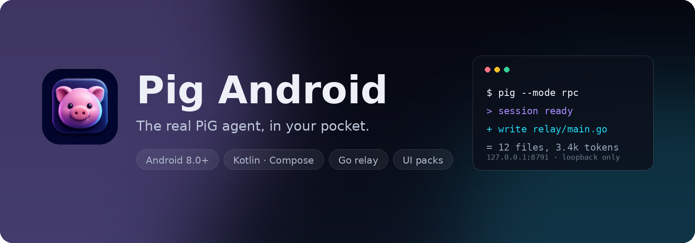

**English** · [简体中文](README.zh-CN.md)

<p align="center">
  
</p>

<h1 align="center">Pig Android</h1>

<p align="center">
  <b>The real PiG agent, in your pocket.</b><br>
  A native Compose client — the model, the tools and the API keys stay in Termux.
</p>

<p align="center">
  <a href="https://github.com/linuxwff789/pig-android/releases/latest"></a>
  <a href="https://github.com/linuxwff789/pig-android/actions/workflows/android.yml"></a>
  
  
  
</p>

## No wrapper, no re-implementation

The app is a thin front-end. It never talks to a model provider and never holds
an API key: every turn is executed by the original `pig` binary inside Termux,
and the app renders the result.

```
┌──────────────┐   TCP 127.0.0.1:8791   ┌────────────┐   stdio JSONL   ┌──────────────┐
│  Pig app     │ ─────────────────────► │ pig-relay  │ ──────────────► │ pig --mode rpc│
│  (Compose)   │ ◄───────────────────── │   (Go)     │ ◄────────────── │   (Termux)    │
└──────────────┘   one JSON per line    └────────────┘                 └──────────────┘
                                          │
                                          └── watches ~/.pig/android-ui and pushes UI packs
```

`pig-relay` is the only bridge: a loopback socket, a per-install token, and
unmodified forwarding of PiG's own RPC frames. There is no pairing screen — the
app starts the relay itself through Termux `RUN_COMMAND`. Kill the app and the
agent keeps working; reopen it mid-turn and the answer continues where it left
off.

## What you get

| | |
| --- | --- |
| 💬 **A real transcript** | Streaming Markdown — GFM headings, lists, tables with alignment, code fences — plus collapsible `思考` blocks, copy buttons and a `回到底部` pill. |
| 🧰 **Tool cards** | Collapse / summary / expand (long-press the chip to apply to all), `write` shows lines and bytes, `edit` shows added/removed counts and a coloured diff. |
| 🧩 **Extension dialogs** | `confirm` / `select` / `input` / `editor` answered natively, themed by the pack, body selectable and copyable; tap to park a prompt and bring it back from the banner. |
| 📋 **Plan checklist** | Any extension that emits a `setWidget` plan becomes a native card with progress bar and `☑ / ☐` steps — no registry, no allow-list. The bundled plan extension ships with `pig-relay`. |
| 🗂 **Sessions** | Drawer with search, rename and delete; per-session drafts; a session that is still being created keeps what you type. |
| 🎛 **Models** | Searchable picker with context size, thinking and image support; pin a default; override a provider's wrong `contextWindow` on the `ctx` line. |
| ➕ **Providers** | Native provider manager: add/edit `custom-endpoints.json`, fetch `/models`, then pick which models to enable in a searchable selection window — no extension-generated form. |
| 🗄 **Backup, restore, uninstall** | One tap packs `~/.pig` (keys, models, settings, extensions, sessions, UI pack) into `Download/Pig`; importing merges it back after an automatic safety backup. Uninstall stops pig and pig-relay and removes their binaries, with an optional `~/.pig` wipe. |
| 🖼 **Images both ways** | Tool and assistant images, a system photo picker, Markdown images, and a full-screen viewer that saves to `Pictures/Pig`. |
| 🎨 **UI packs** | Theme, typography, layout, strings, icons, nav entries and windows hot-reload from `~/.pig/android-ui` — restyle the whole app without a rebuild. |
| 🔔 **Notifications** | Turn finished, needs your input, error, context compacted — separate channels, per-channel sound, per-state toggles. |
| 🔒 **Keys stay put** | Token-authenticated loopback only; `~/.pig/agent/auth.json` is never visible to the app. |

Deep dives — reconnect and mid-turn reattach, image pipeline, thinking blocks,
cache numbers, tuning switches — live in [docs/features.md](docs/features.md).

## Install

The APK is only the front-end. Install
[Termux from F-Droid](https://f-droid.org/packages/com.termux/) (the Play Store
build is obsolete), open it once so `pkg` initializes, then run:

```bash
pkg install -y curl
curl -fsSL https://github.com/linuxwff789/pig-android/releases/latest/download/install-termux.sh | sh
```

The script enables `allow-external-apps` (keeping a backup), installs `pig` with
the official installer, downloads `pig-relay-android-arm64` from the latest
release and creates `~/.pig/android-ui`. Open Termux once more so the property
reloads, then install the APK and grant
`com.termux.permission.RUN_COMMAND`.

If the app shows the setup dialog, it offers the same two lines with a copy
button. **一键安装** only works when `allow-external-apps` is already enabled;
otherwise paste them into Termux by hand. The manual route and troubleshooting
are in [docs/install.md](docs/install.md).

## Update

**设置 → 关于 → 检查更新** compares the installed version with the latest GitHub
release. Install the new `app-release.apk` over the old one — same signing key,
so your data stays.

A new `pig-relay` is not picked up by a running process: rerun the install
script (or copy the binary into `$PREFIX/bin`) and then use
**设置 → 连接 → 重启 relay**.

## What's new

- **1.1.1** — a relay token mismatch heals itself: after a reinstall the app
  re-reads the token from prefs and, if needed, restarts the relay with the
  right one instead of showing `auth failed: bad token`.
- **1.1.0** — images everywhere: tool and assistant images, a photo picker in
  the composer, Markdown images, and a viewer with save-to-gallery.
- **1.0.0** — first minified release: launcher icon, notifications with a
  selectable sound, thinking blocks, plan widgets, usage statistics.

Full history: [releases](https://github.com/linuxwff789/pig-android/releases).

## Docs

| Document | What is inside |
| --- | --- |
| [install.md](docs/install.md) | Termux backend: script, manual route, troubleshooting |
| [ui-pack.md](docs/ui-pack.md) | Every pack key: colours, typography, layout, strings, windows |
| [app-ui.md](docs/app-ui.md) | `app-ui/1`: JSON windows rendered with Compose |
| [plan-widget.md](docs/plan-widget.md) | The `setWidget` plan contract |
| [protocol.md](docs/protocol.md) | Relay wire protocol (`relay/1`) |
| [features.md](docs/features.md) | Behaviour in depth: reconnects, images, thinking, tuning |
| [development.md](docs/development.md) | Building, running and debugging locally |

Optional Go extensions in this repository: [plan](extensions/plan/README.md)
(read-only planning mode with a tickable plan card),
[rtk](extensions/rtk/README.md) (compressed tool output) and
[subagent](extensions/subagent/README.md) (child agents with their own context).

## Security

- The relay binds to `127.0.0.1` only and requires the token in the first frame.
- `allow-external-apps=true` lets any app holding `RUN_COMMAND` execute commands
  in Termux. That is the price of the pairing-free launch path — if you would
  rather not pay it, start the relay from a Termux service instead.
- API keys stay in Termux (`~/.pig/agent/auth.json`); the app never sees them.
